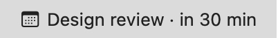

# NextUp

A macOS menu bar app that shows your next meeting and how long until it starts.

<p>
  
  
</p>



The screenshots use made-up demo meetings.

## What it does

The menu bar shows a calendar icon and, when there is something to show, the next meeting's title with a countdown:

- `Design review · in 30 min` before a meeting starts
- `Sprint planning · 12 min left` while one is running
- `... · now` in the last minute before a start
- Just the icon when nothing else is left today, or when calendar access is missing

If a meeting starts within 10 minutes, it takes over the label from the one in progress. Titles longer than 22 characters are cut short.

Click the label to open the popover. It has a card for the current or next meeting (time range, countdown, progress bar while it runs, and a Join button if a link was found), then a list of what is coming up. Clicking a row with a video link opens the link.

The list shows every meeting left today. If that is fewer than 4, it is topped up from the following days to reach 4. Events within the next 7 days are considered. These are hidden: all-day events, cancelled events, and events you declined.

Join links are picked out of an event's URL, location and notes. Google Meet, Zoom and Microsoft Teams links are recognised.

## Requirements

- macOS 14 or later
- Xcode command line tools (Swift 5.9 or later)

## Install

```sh
git clone https://github.com/alexissan/NextUp.git
cd NextUp
./build.sh
```

The script builds a release binary, wraps it in `NextUp.app`, signs it ad hoc, copies it to `/Applications` (replacing any earlier copy, and quitting a running one first), and launches it.

## First run

Allow calendar access when macOS asks. NextUp reads whatever the Calendar app can see, so Google or Outlook calendars need their account added in System Settings → Internet Accounts first.

## Try it without calendar access

```sh
open -a NextUp --args --demo
```

This skips the calendar completely and shows invented meetings positioned around the current time.

## Privacy

NextUp reads your calendars on your Mac through EventKit. The code has no networking and writes no files of its own. Opening a Join link hands the URL to your default browser or app. The "Launch at login" checkbox registers a login item with macOS.

## Uninstall

Quit NextUp from its popover, then delete `/Applications/NextUp.app`.

## Known limits

- The app is ad-hoc signed, so there is no prebuilt download. You build it yourself.
- macOS may ask for calendar access again after a rebuild, because the signature changes.
- There is no app icon yet.

## Development

```sh
swift test
```

- `Sources/NextUpCore` has the pure logic: which meetings are shown, the labels and countdowns, join link detection. This is what the tests cover.
- `Sources/NextUp` is the SwiftUI app: `CalendarStore` (EventKit), `PopoverView`, `DemoData`, and the menu bar entry point.
- `build.sh` builds and installs the app bundle. `Resources/Info.plist` is its manifest.

The README images are regenerated from demo data, without touching the screen or your calendar:

```sh
swift build -c release
.build/release/NextUp --render-screenshots docs
```

## Licence

MIT. See [LICENSE](LICENSE).
