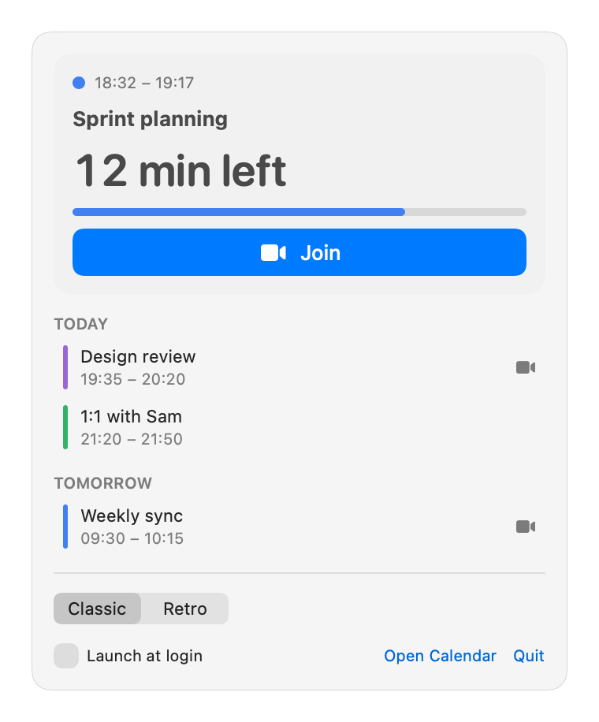
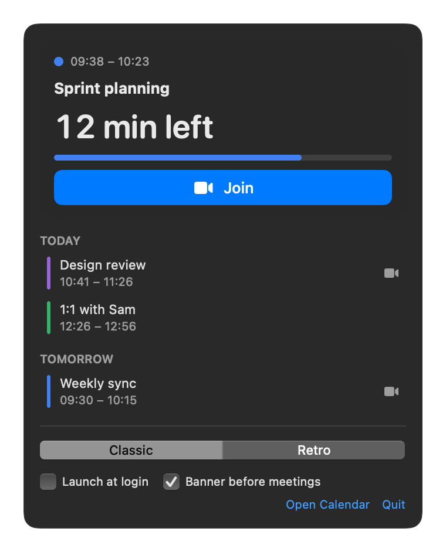
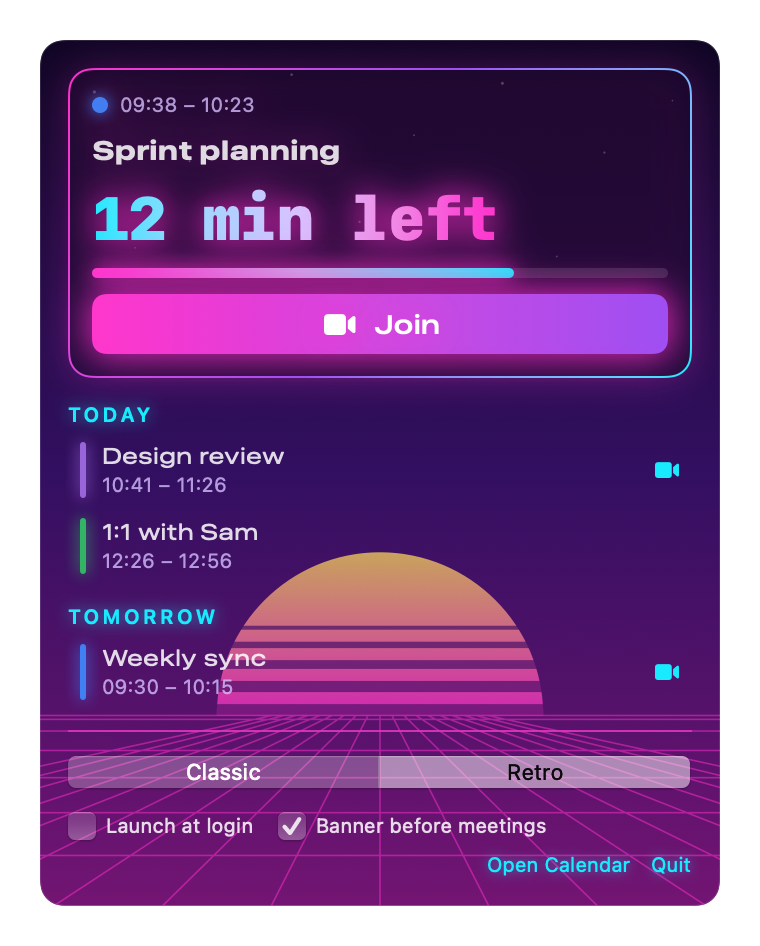

# NextUp

**Your next meeting, always one glance away.** NextUp is a small macOS menu bar app that shows what's coming up and how long you have, with a one-click Join for Meet, Zoom and Teams.

<p align="center">
  
  
  
</p>

<p align="center">
  
</p>

<p align="center"><sub>Screenshots use made-up demo meetings.</sub></p>

## Highlights

- **A countdown in the menu bar.** `Design review · in 30 min`, then `12 min left` once it starts.
- **One-click Join.** Google Meet, Zoom and Microsoft Teams links are found in the event's URL, location or notes.
- **The rest of your day at a glance**, topped up from the next days when today is quiet.
- **Two looks.** Classic follows your Mac's light or dark appearance. Retro is full synthwave: neon grid, striped sunset, glowing countdown.
- **Private by design.** It reads your calendar on your Mac through EventKit. No network code, no accounts, no files written.

## Quick start

You need macOS 14 or later and the Xcode command line tools (Swift 5.9+).

```sh
git clone https://github.com/alexissan/NextUp.git
cd NextUp
./build.sh
```

`build.sh` builds a release binary, wraps it in `NextUp.app`, signs it (ad hoc, unless you have made a local certificate), installs it in `/Applications` (quitting and replacing any earlier copy), and launches it.

When macOS asks, allow calendar access. NextUp sees whatever the Calendar app sees, so add Google or Outlook accounts in **System Settings → Internet Accounts** first.

Want a look before granting access? Demo mode skips the calendar and invents meetings around the current time:

```sh
open -a NextUp --args --demo
```

## How it works

### The menu bar label

| Situation | Label |
|---|---|
| A meeting is coming up | `Design review · in 30 min` |
| A meeting is running | `Sprint planning · 12 min left` |
| Less than a minute to go | `Design review · now` |
| Nothing left today, or no calendar access | the calendar icon alone |

A meeting starting within 10 minutes takes over the label from one still in progress, so you never miss the next one. Titles longer than 22 characters are shortened.

### The popover

Click the label to open it:

- **Hero card** for the current or next meeting: time range, countdown, a progress bar while it runs, and **Join** when a video link was found.
- **Coming up**, grouped by day. Rows with a video icon open their call when clicked.
- **Mode selector** (Classic or Retro), remembered across launches.
- **Launch at login**, **Open Calendar** and **Quit**.

The list shows every meeting left today. If that's fewer than 4, it's topped up from the following days, looking up to 7 days ahead. All-day events, cancelled events and events you declined are left out. Everything refreshes every 30 seconds, when your calendar changes, and when your Mac wakes.

### Modes

| | Classic | Retro |
|---|---|---|
| Appearance | follows the system, light or dark | always dark |
| Backdrop | system material | night-purple sky, stars, striped sun on a neon grid |
| Countdown | rounded, semibold | heavy monospaced, cyan-to-magenta glow |
| Accents | system accent colour | magenta, violet and cyan |

Your calendar colours are kept in both modes, because they carry meaning. Retro dims its backdrop when **Increase Contrast** is turned on.

### Accessibility

Meeting rows read as one element, and rows with a call are announced as buttons with a hint. Day headers are marked as headings. The progress bar reports its percentage, and the decorative Retro backdrop is hidden from VoiceOver.

## Troubleshooting

**No meetings show up.** Check that NextUp is allowed in **System Settings → Privacy & Security → Calendars**, and that the calendar shows up in the Calendar app.

**macOS asks for calendar access again after a rebuild.** By default the app is ad-hoc signed, so the permission belongs to one exact build. When `build.sh` installs a build the old permission no longer covers, it clears it so macOS asks again. To stop this happening, run `./make-signing-cert.sh` once before `./build.sh`: it creates a self-signed certificate called "NextUp Local Signing" in your login keychain, `build.sh` signs with it from then on, and the permission follows the certificate instead of one exact build. To undo it, delete the certificate in Keychain Access.

**NextUp is allowed under Calendars, but no meetings show.** The switch belongs to an earlier build. Clear it and relaunch:

```sh
tccutil reset Calendar dev.alexissantos.nextup
```

**The label is missing from the menu bar.** NextUp is still running; macOS hides menu bar items that don't fit beside the notch, and the label is wide. Remove or hide another menu bar icon to make room.

**A call link isn't detected.** Only Meet, Zoom and Teams links are recognised for now. The link must be in the event's URL, location or notes.

## Uninstall

Quit NextUp from its popover, turn off **Launch at login** if you enabled it, then delete `/Applications/NextUp.app`.

## Development

```sh
swift test
swift run NextUp --demo
```

| Path | What's there |
|---|---|
| `Sources/NextUpCore` | Pure logic, covered by the tests: which meetings show, labels and countdowns, join-link detection, the stored `Theme` |
| `Sources/NextUp` | The SwiftUI app: `CalendarStore` (EventKit), `PopoverView`, `Palette` (per-mode styling and the Retro backdrop), `DemoData`, and the menu bar entry point |
| `Resources/Info.plist` | The app bundle's manifest |
| `build.sh` | Builds, signs and installs the app |

The images in `docs/` are rendered offscreen from demo data, without touching the screen or your calendar:

```sh
swift run NextUp --render-screenshots docs
```

## Known limits

- No prebuilt download yet: the app is ad-hoc signed, so you build it yourself.
- No app icon yet.

## Licence

MIT. See [LICENSE](LICENSE).
